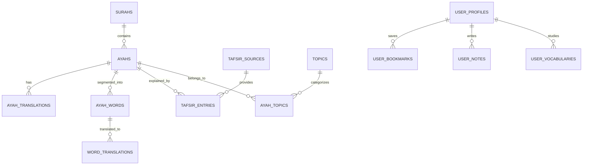

# Database Schema & Entity Documentation — Al-Quran Platform

This document describes the PostgreSQL database schema deployed via Supabase migrations (`supabase/migrations/20261019_initial_schema.sql`).

---

## 1. Entity-Relationship Overview

---

## 2. Table Specifications

### A. Canonical Quran Content

#### `surahs`
Primary catalog of the 114 chapters of the Holy Quran.
- `number` (INTEGER, PK): Surah number (1-114).
- `name_ar` (TEXT): Arabic name in calligraphy (e.g. الفاتحة).
- `name_en` (TEXT): English name (e.g. Al-Fatihah).
- `name_transliteration` (TEXT): Phonetic transliteration.
- `name_bn` (TEXT): Bangla name (e.g. আল-ফাতিহা).
- `translation_en` (TEXT): English translation of the name.
- `translation_bn` (TEXT): Bangla translation of the name.
- `verses_count` (INTEGER): Total number of verses in the Surah.
- `revelation_place` (TEXT): 'Meccan' or 'Medinan'.
- `revelation_order` (INTEGER): Chronological order of revelation.
- `juz_start` (INTEGER): Starting Juz (1-30).
- `page_start` (INTEGER): Starting page in the standard Mushaf.
- `bismillah_pre` (BOOLEAN): Whether Bismillah precedes the Surah.

#### `ayahs`
Canonical verse records.
- `id` (TEXT, PK): Composite format `${surah_number}:${ayah_number}` (e.g. '1:1').
- `surah_number` (INTEGER, FK -> surahs.number).
- `ayah_number` (INTEGER): Verse number within chapter.
- `text_ar` (TEXT): Authentic Uthmani script with full diacritics.
- `text_plain` (TEXT): Simplified script for full-text indexing.
- `juz` (INTEGER): Juz index.
- `hizb` (INTEGER): Hizb index.
- `page` (INTEGER): Mushaf page.
- `sajdah` (BOOLEAN): Indicates required prostration.

#### `ayah_words`
Word-by-word tokenized segmentation.
- `id` (TEXT, PK): Composite format `${surah}:${ayah}:${position}`.
- `surah_number` (INTEGER, FK -> surahs.number).
- `ayah_number` (INTEGER).
- `position` (INTEGER): Sequential word position within verse.
- `arabic` (TEXT): Uthmani word token.
- `transliteration` (TEXT): Word pronunciation.
- `root_arabic` (TEXT): 3 or 4 letter Arabic root.
- `lemma` (TEXT): Canonical lemma form.
- `part_of_speech` (TEXT): Noun, verb, particle, etc.
- `grammar_notes` (TEXT): Syntactic role analysis.

---

### B. Tafsir & Exegesis

#### `tafsir_sources`
Exegetical works and authors.
- `id` (TEXT, PK): Identifier (e.g. 'ibn-kathir', 'ahsanul-bayaan', 'jalalayn').
- `name` (TEXT): Formal name of commentary.
- `author` (TEXT): Scholar attribution.
- `language` (TEXT): 'en', 'bn', or 'ar'.
- `description` (TEXT): Scope and methodology summary.

#### `tafsir_entries`
Commentary per verse.
- `id` (UUID, PK).
- `surah_number` (INTEGER).
- `ayah_number` (INTEGER).
- `source_id` (TEXT, FK -> tafsir_sources.id).
- `text` (TEXT): Full commentary.
- `asbab_al_nuzul` (TEXT): Historical occasion of revelation.
- `linguistic_notes` (TEXT): Grammatical and syntactic analysis.
- `authentic_hadith_refs` (JSONB): Array of verified Hadith citations.

---

### C. Personal Study & Spaced Repetition (RLS Protected)

#### `user_bookmarks`
Private user saved Ayahs.
- `id` (UUID, PK).
- `user_id` (UUID, FK -> auth.users.id).
- `surah_number` (INTEGER).
- `ayah_number` (INTEGER).
- `note` (TEXT): Personal bookmark label.
- *RLS Policy*: `auth.uid() = user_id`.

#### `user_notes`
Private reflections and study notes.
- `id` (UUID, PK).
- `user_id` (UUID, FK -> auth.users.id).
- `surah_number` (INTEGER).
- `ayah_number` (INTEGER).
- `title` (TEXT): Note title.
- `content` (TEXT): Reflection body.
- *RLS Policy*: `auth.uid() = user_id`.

#### `user_vocabularies`
Spaced Repetition System (SM-2) review queue.
- `id` (UUID, PK).
- `user_id` (UUID, FK -> auth.users.id).
- `word_arabic` (TEXT): Target word.
- `transliteration` (TEXT).
- `translation_en` (TEXT).
- `translation_bn` (TEXT).
- `next_review_date` (TIMESTAMPTZ).
- `interval` (INTEGER): Spacing in days.
- `ease_factor` (NUMERIC): Default 2.5.
- `repetitions` (INTEGER): Successful recall count.
- `status` (TEXT): 'new' | 'learning' | 'mastered'.
- *RLS Policy*: `auth.uid() = user_id`.
